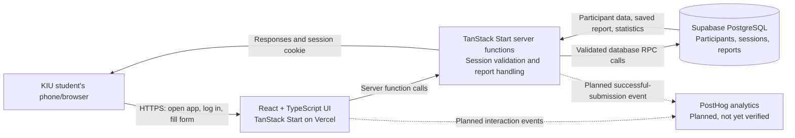

# Architecture

**Project:** KIU Laundry — Campus Laundry Problem Reporting

**Live application:** https://laundrykiu.vercel.app

**Official team repository:** https://github.com/Avto30/pdfse-f26-gan

**Application source repository:** https://github.com/NitaJ5/Laundry

**MVP boundary:** `03-build/mvp-boundary.md`

**Analytics schema:** `03-build/analytics/event-schema.md`

This document describes the existing technical implementation and the remaining instrumentation work needed to support the selected MVP journey.

The objective is to deliver a functioning reporting journey at a public URL, not to introduce a new technology stack.

## The diagram

**Diagram legend:**

- Solid arrows represent the existing application's principal data flow.
- Dashed arrows represent planned PostHog instrumentation, not functionality that has been confirmed as deployed.
- Supabase credentials remain on the server, not in the student's browser.
- No email, SMS, WhatsApp, maintenance notification, or external messaging service is part of the MVP journey.

The application uses the original reporting concept but is a separate implementation from the Lovable clickable prototype.

The Lovable prototype simulates submissions. The Vercel application uses database-backed submissions.

## The stack, one line per layer

| Layer | Choice | Why we can deploy it by Week 7 |
|---|---|---|
| Hosting | Vercel — `https://laundrykiu.vercel.app` | The team has already established a public Vercel deployment, so no additional hosting platform is required for the reporting journey. |
| Frontend | React, TypeScript, and TanStack Start | The application already implements the reporting interface, confirmation screen, and personal statistics. Nita has worked on the existing implementation. |
| UI state and data fetching | React state and TanStack Query | Already used for reporting form state, participant queries, session updates, and refreshed statistics. |
| Server-side application logic | TanStack Start server functions | Login, session checking, reporting, and statistics use existing server functions. No separate backend service is required. |
| Database | Supabase PostgreSQL | The application already stores participant accounts, session records, and equipment-problem reports in Supabase. |
| Database access | Server-side Supabase client and PostgreSQL RPC functions | The existing application uses server functions to invoke database operations without exposing privileged database credentials to browser code. |
| Analytics | PostHog | Required by the course; six events are defined in `03-build/analytics/event-schema.md`. Instrumentation and event reconciliation remain outstanding. |
| Sign-in | Username-based participant accounts with persistent UUIDs | Already implemented and sufficient for the controlled reporting experiment, but not secure student identity verification. |
| Session management | HTTP-only cookie and hashed session token | Already implemented; database-backed session records support session checking and revocation. |
| Messages out | None | The MVP delivers confirmation on-screen and does not promise that a maintenance team receives a notification. |

**Layers we deliberately do not have in Sprint 1:**

Real-time laundry-machine integrations, automatic fault diagnostics, maintenance staff dashboards, maintenance notifications, reservations, payment processing, AI chatbots, and independent background-processing services.

The current experiment tests whether students can submit a specific equipment-problem report. These additional systems are not required to complete that action.

### Application implementation

The frontend and server logic are maintained in the independent application repository:

`https://github.com/NitaJ5/Laundry`

Important files include:

- `src/routes/index.tsx` — Reporting flow, navigation, validation feedback, and confirmation.
- `src/components/participant-login.tsx` — Username registration and login interface.
- `src/components/participant-activity.tsx` — Participant reporting totals and weekly history.
- `src/lib/laundry-report.ts` — Machine identifiers, issue options, and form validation.
- `src/lib/participant.ts` — Participant types and Zod validation schemas.
- `src/lib/participant.functions.ts` — Server functions for login, session checking, report submission, and activity.
- `src/lib/participant.server.ts` — Session token creation, hashing, cookie management, and session checks.
- `src/integrations/supabase/client.server.ts` — Server-only Supabase client.
- `src/integrations/supabase/types.ts` — Generated types describing database tables, views, and RPC functions.

The application is deployed separately from the official course repository.

The team must still resolve the course requirement to place application code in the team repository's `app/` directory or obtain lecturer approval for the separate repository arrangement.

## The journey through the stack

The five steps below correspond to `03-build/mvp-boundary.md`.

Events are copied from the documented analytics schema. They are planned capture points, not verified PostHog events.

| Step | Layer that handles it | Event fired |
|---|---|---|
| 1 | React UI begins reporting; TanStack Start server functions handle username login and session establishment through Supabase. Returning participants can reuse an existing valid session. | `student_completed_username_login` — planned after successful explicit login; not emitted merely because a returning session already exists. |
| 2 | The server checks participant identity, and React displays the authenticated reporting form. | `student_opened_problem_form` — planned when the form becomes available. |
| 3 | React form controls collect building, machine type, and machine identifier using options defined in `laundry-report.ts`. | `student_selected_laundry_machine` — planned after a valid machine selection. |
| 4 | React form controls collect the predefined problem or custom problem choice; application and server validation check the submitted values. | `student_selected_problem_type` — planned when a problem option is selected. |
| 5 | TanStack Start server function validates the request, invokes the Supabase `submit_participant_report` RPC, receives the saved report, and returns confirmation to the browser. | `student_submitted_problem_report` — planned only after successful database persistence. |

**North star step:** 5.

**North star event:** `student_submitted_problem_report`

**North star metric:** Successfully submitted laundry equipment-problem reports per week per user.

The event must represent an actual saved database report. An attempted submission, invalid form, failed database operation, or duplicated analytics delivery must not increase the metric.

The saved report's unique `report_id` allows analytics events to be reconciled with database records.

## Existing database structure

The generated Supabase types in the application repository identify the following core tables.

| Table | Relevant fields | Purpose |
|---|---|---|
| `public.participants` | `id`, `username`, `created_at` | Associates a username with a persistent participant UUID. |
| `public.participant_sessions` | `id`, `user_id`, `session_token_hash`, `created_at`, `expires_at`, `revoked_at` | Tracks participant sessions and their revocation or expiry. |
| `public.laundry_reports` | `id`, `user_id`, `request_id`, `building`, `machine_type`, `machine_id`, `issue`, `custom_description`, `created_at`, `status`, `deleted_at` | Stores submitted laundry equipment-problem reports. |

The generated types also identify a `participant_weekly_statistics` view.

The application's server functions use these database operations:

- `participant_login` — Associates a participant username and session hash.
- `participant_identity` — Retrieves participant identity using a session hash.
- `submit_participant_report` — Submits a validated equipment-problem report.
- `participant_activity` — Retrieves participant reporting statistics.

The application uses the database to persist report data and calculate reporting activity.

The presence of generated types and RPC calls does not, by itself, establish that every live database privilege or policy has been independently audited.

## Secrets and data

### Secrets and environment variables

The application uses the following server-side environment variables in `src/integrations/supabase/client.server.ts`:

| Variable | Purpose | Exposure rule |
|---|---|---|
| `SUPABASE_URL` | Identifies the Supabase project endpoint | Read by server-side application code. |
| `SUPABASE_SERVICE_ROLE_KEY` | Authorizes privileged Supabase operations | Must remain server-only and must never be sent to the browser or committed to Git. |

The server-side Supabase client uses a privileged key capable of bypassing Row Level Security.

Therefore, all access through this client must remain behind trusted server functions that validate requests and participant sessions.

The source code uses a dynamically imported server-side Supabase client inside the server function handlers.

**Environment configuration:** Production credentials should be stored in the Vercel project's environment variable settings. Local credentials, if used, should remain in ignored local environment files.

**Repository verification finding:** The application repository's current `.gitignore` contains `*.local` but does not explicitly ignore `.env` or all `.env.*` files.

This must be corrected and verified. Until that correction is committed, the environment-file protection requirement is not fully satisfied.

No secret values should appear in this document, source control, public logs, or analytics events.

### Participant sessions

The application implements a custom username-based participant session system.

After successful username login:

1. The server creates a random session token.
2. The token is hashed using SHA-256.
3. The session information is managed through Supabase.
4. The original token is stored in an HTTP-only browser cookie.
5. Subsequent server requests use the cookie token to identify the participant session.

The cookie is configured with HTTP-only access, `SameSite=Lax`, and the `Secure` attribute for HTTPS requests.

The application uses private, non-cacheable responses for session-related operations.

The configured session duration is 365 days.

**Security limitation:** Username-only login does not prove that a participant is the person who originally created or used that username. Someone who knows another participant's username may be able to access that participant's account and reporting history.

The session mechanism reduces accidental token exposure but does not solve the underlying identity-verification problem.

This sign-in model should be treated as suitable only for the limited experiment until a stronger identity model is designed and verified.

### Personal data

The database stores participant usernames and persistent participant IDs.

Reports store building, machine type, machine identifier, selected issue, optional custom problem description, timestamps, and identifiers needed to associate the report with a participant.

A custom problem description is free text and could contain personal information entered by the participant. It should therefore be treated as potentially sensitive application data.

The application should avoid logging free-text descriptions unnecessarily and must not send them to analytics.

### Analytics privacy

The planned PostHog events use a persistent pseudonymous `participant_id`.

Permitted event properties include machine type, building, machine identifier, report ID, submission timestamp, and non-sensitive interaction metadata defined in the event schema.

Events must not include:

- Participant usernames.
- Real names, emails, or phone numbers.
- Session tokens or session-token hashes.
- Supabase secret keys.
- Custom problem description text.
- Unnecessary personal information.

The North Star event should be associated with the same persistent participant UUID used by the database.

Database report records remain the authoritative source for reconciliation.

## Analytics and reconciliation

**Current state:** The application already supports successful database submissions and participant reporting statistics.

**Outstanding:** PostHog instrumentation, confirmed event capture, and reconciliation of analytics against Supabase records.

The following events are defined in `03-build/analytics/event-schema.md`:

1. `student_completed_username_login`
2. `student_opened_problem_form`
3. `student_selected_laundry_machine`
4. `student_selected_problem_type`
5. `student_submitted_problem_report`
6. `student_opened_reporting_statistics`

The first five map to the minimum reporting journey. The sixth measures optional interaction with the existing statistics interface.

For the North Star event, instrumentation must occur after a successful save response and must preserve the saved `report_id`.

If analytics events are delivered more than once, report IDs must be deduplicated for metric calculation.

To reconcile:

1. Choose a completed ISO week using the Asia/Tbilisi time zone.
2. Count saved database reports per participant UUID.
3. Count distinct PostHog successful-submission events per participant UUID and `report_id`.
4. Compare the totals.
5. Investigate missing events, duplicate events, participant ID mismatches, and date-boundary errors.

PostHog counts should not be treated as verified until this comparison is completed.

## Deployment and operational risks

| Risk | Why it matters | Mitigation |
|---|---|---|
| Missing or incorrect Supabase environment variables | Server functions may be unable to log in participants or save reports. | Verify that the required server-only environment variables exist in the correct Vercel deployment environment and test one controlled report after deployment. |
| Privileged Supabase key exposed publicly | A leaked service key could permit unauthorized database access. | Keep the key server-only, explicitly ignore local environment files, audit committed files, and rotate any key discovered to have been exposed. |
| Username-only account impersonation | Anyone knowing an existing username may be able to access its reporting history. | Clearly disclose the experimental limitation, minimize sensitive data, and implement stronger authentication before wider use. |
| Analytics event missing after a successful save | Supabase could contain a valid report while PostHog records no North Star event. | Capture the event only after confirmed persistence; compare saved report IDs against PostHog events. |
| Duplicate analytics events | Retries can inflate the North Star count. | Associate events with the saved `report_id` and deduplicate during reconciliation. |
| Incorrect participant attribution | A report could be associated with one database participant but a different analytics identity. | Use the persistent participant UUID consistently and verify counts per participant. |
| Incorrect weekly boundaries | Week-based counts may disagree if analytics and database calculations use different time zones. | Use ISO Monday-start weeks and the Asia/Tbilisi time zone consistently. |
| Vercel build or runtime incompatibility | The application uses an existing TanStack/Vite configuration inherited from its original development setup. Changes to deployment settings could affect server functions. | Preserve the known working configuration, inspect deployment logs after changes, and verify login, report persistence, and confirmation on the public URL. |
| Separate application repository | The application is not stored in the official course repository's `app/` directory. | Place the application there or obtain explicit lecturer approval for maintaining the separate source repository. |
| Missing independent usability evidence | Passing technical checks does not establish that dormitory residents can complete the task unaided. | Conduct and document the required formal participant sessions using the frozen prototype task. |

### The one thing most likely to break the Week 7 delivery requirement

**Unimplemented or incorrectly reconciled PostHog instrumentation.**

The current application already saves equipment-problem reports, but the course's Week 7 gate also requires a deployed and instrumented journey.

The main risk is that the application appears to function correctly while `student_submitted_problem_report` is absent from PostHog, duplicated, or attributed to the wrong participant.

This is the first outstanding analytics issue to resolve before declaring the Week 7 gate complete.

### First verification on the deployed application

Use a controlled test participant and submit a clearly identified test report.

Verify that:

1. The participant can log in.
2. The reporting form accepts a valid machine and issue.
3. The database stores the report once.
4. The confirmation screen displays the saved report.
5. The reporting statistics reflect the saved record.
6. After PostHog is implemented, the analytics system records the corresponding successful-submission event.
7. The event's `report_id` and participant UUID match the database record.
8. Failed or duplicate attempts do not inflate the North Star metric.

Previously completed functional tests remain valid evidence of the implementation tested at that time. New verification is required for changes to analytics or deployment configuration.

## Current architecture status

**Implemented in the application:**

- React and TypeScript reporting interface.
- TanStack Start application and server functions.
- Vercel deployment.
- Supabase-backed participant accounts and sessions.
- Database-persisted equipment-problem reports.
- Validation and confirmation.
- Personal weekly and all-time reporting statistics.

**Documented but not yet verified as implemented:**

- PostHog capture for the six analytics events.
- North Star reconciliation with Supabase.
- Compliance with the course's application-source location requirement.
- Complete local environment-file ignore protection.

**Not part of the MVP:**

Live machine availability, verified equipment diagnostics, reservations, maintenance integration, external notifications, and guaranteed repairs.

The architecture supports the team's current experiment: whether KIU dormitory residents can independently submit structured reports about specific equipment problems.
